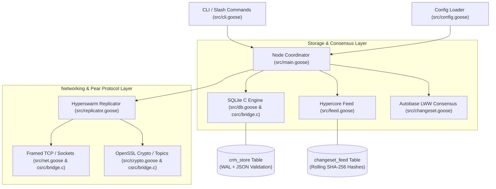

# Architecture & Pear Protocol Implementation

`goose-sql-p2p` is a high-performance, peer-to-peer SQLite replication engine written in the [Goose programming language](https://aardappel.github.io/goose). It compiles directly to native C, interfacing with SQLite 3 amalgamation (`libsqlite3`) and OpenSSL 3.0 with zero runtime overhead while maintaining full protocol and configuration parity with the Pear P2P stack.

---

## 1. High-Level Architecture Overview



---

## 2. Pear Protocol Implementation Mapping

The Pear protocol stack consists of four core building blocks: **Hypercore**, **Autobase**, **Hyperswarm**, and **Framed Wire Transport**. Here is how each is implemented in `goose-sql-p2p`:

### 2.1 Hypercore Binary Changeset Feed

- **Goose Module**: [`src/feed.goose`](src/feed.goose)
- **Database Schema**: `changeset_feed` table in SQLite (`seq`, `timestamp`, `op`, `key`, `metadata`, `prev_hash`, `data`)
- **Key Functions**:
  - `feed::append_changeset`: Appends a mutation entry and computes a continuous, cryptographically verifiable rolling **SHA-256 state hash** over `(prev_hash, seq, op, key, metadata, data)`.
  - `feed::verify_feed`: Traverses and verifies the cryptographic Merkle/hash integrity chain from block `seq = 1` through to the tip.

```
+---------------------------------------------------------------------------------+
| Hypercore Changeset Feed Block (seq: N)                                         |
| prev_hash: SHA256(Block N-1) | op: PUT | key: "user:1" | data: "Alice"          |
| current_hash: SHA256(prev_hash + seq + op + key + metadata + data)              |
+---------------------------------------------------------------------------------+
```

### 2.2 Autobase Multi-Writer Causal Consensus (LWW)

- **Goose Module**: [`src/changeset.goose`](src/changeset.goose)
- **Consensus Strategy**: Deterministic Last-Write-Wins (LWW) conflict resolution using nanosecond timestamps and vector sequence numbers.
- **Key Functions**:
  - `changeset::encode`: Serializes in-memory mutations into framed wire payloads.
  - `changeset::decode`: Deserializes incoming changesets.
  - `changeset::apply_lww`: Compares incoming changeset timestamps against local record metadata. If incoming timestamp $\ge$ local timestamp, the mutation (Insert, Update, or Tombstone Delete) is committed to SQLite; otherwise, stale writes are rejected without data divergence.

### 2.3 Hyperswarm Discovery & Peer Pooling

- **Goose Module**: [`src/replicator.goose`](src/replicator.goose)
- **Key Functions**:
  - `replicator::init_replicator`: Spawns the swarm server listener and manages the active peer socket pool (`peer_fds`).
  - `replicator::connect_to_peer`: Establishes outbound connections to configured bootstrap/DHT peers and immediately initiates full state synchronization (`sync_local_to_peer`).
  - `replicator::poll_and_sync`: Non-blocking replication engine loop that accepts incoming connections and processes pending wire frames.
  - `replicator::broadcast_changeset`: Fan-out engine that broadcasts local mutations to all active peers in real time.

### 2.4 Framed Wire Transport & Native Bridge

- **Goose Module**: [`src/net.goose`](src/net.goose)
- **C Native Bridge**: [`csrc/bridge.c`](csrc/bridge.c)
- **Wire Specification**:
  - **Framing**: 4-byte big-endian length prefix (`uint32_t` via `htonl`/`ntohl`) followed by the payload bytes.
  - `gs_sock_send_framed`: Sends length-prefixed frames reliably with `MSG_NOSIGNAL` and error recovery.
  - `gs_sock_recv_framed`: Performs non-blocking framed socket reception using POSIX `poll()` timeouts.
  - `gs_sock_open_udp` / `gs_sock_send_udp`: Broadcasts LAN discovery beacons for zero-configuration local peer discovery.

### 2.5 32-Byte Swarm Topics & Cryptography

- **Goose Module**: [`src/crypto.goose`](src/crypto.goose)
- **C Native Bridge**: [`csrc/bridge.c`](csrc/bridge.c)
- **Key Functions**:
  - `crypto::sha256`: Generates deterministic 32-byte swarm discovery keys from topic strings (`crypto::sha256(cfg.swarm_topic)`).
  - `crypto::encrypt` / `crypto::decrypt`: AES-256-GCM authenticated cipher for payload-level privacy.
  - `crypto::base32_encode`: RFC-4648 Base32 pseudonym encoding for node addresses.

---

## 3. Storage Architecture

```
SQLite Database (WAL Mode)
├── Table: crm_store
│   ├── key      TEXT PRIMARY KEY
│   ├── metadata TEXT CHECK(json_valid(metadata))
│   └── data     BLOB / TEXT
└── Table: changeset_feed
    ├── seq       INTEGER PRIMARY KEY AUTOINCREMENT
    ├── timestamp INTEGER
    ├── op        INTEGER (1=Insert, 2=Update, 3=Delete)
    ├── key       TEXT
    ├── metadata  TEXT
    ├── prev_hash TEXT
    └── data      BLOB / TEXT
```

- **Write-Ahead Logging (WAL)**: Enabled by default (`PRAGMA journal_mode=WAL;`), providing high-concurrency non-blocking reads during peer synchronization writes.
- **JSON Metadata Constraints**: SQLite enforces schema validity on all document metadata via `CHECK(json_valid(metadata))`.

---

## 4. Verification & Testing

The replication engine and protocol stack are validated via:

1. **Unit Test Suite** ([`src/unit_test.goose`](src/unit_test.goose)): Validates crypto primitives, JSON parsing, SQLite C bindings, LWW consensus logic, and Hypercore append logs against an in-memory SQLite database.
2. **E2E & Cross-Replication Test** ([`scripts/cross-replication-test.sh`](scripts/cross-replication-test.sh)): Spins up multiple independent nodes across separate ports and verifies bidirectional data synchronization, tombstone deletion propagation, and state convergence.
