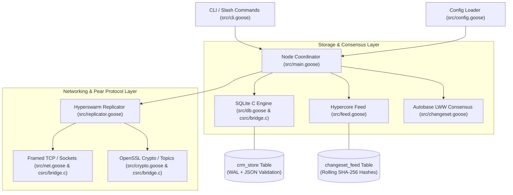

# goose-sql-p2p

A high-performance, decentralized, peer-to-peer SQLite replication engine implemented in the [Goose programming language](https://aardappel.github.io/goose), featuring direct C-native SQLite 3 amalgamation integration, Pear protocol compatibility (Hypercore, Hyperswarm, Autobase LWW consensus), and drop-in configuration parity with `sqlite-p2p`.

---

## Key Features

- **Direct SQLite 3 C Integration**: Interfaces directly with native SQLite 3 amalgamation (`libsqlite3`) via Goose C-native FFI, supporting full Write-Ahead Logging (`WAL` mode) and schema-level `CHECK(json_valid(metadata))` integrity constraints.
- **Pear Protocol Parity**:
  - **Hypercore Feed**: Binary append-only changeset feed with continuous rolling SHA-256 Merkle/state hashing.
  - **Hyperswarm Discovery**: 32-byte swarm topic key derivation, dynamic port binding, and TCP connection pooling.
  - **Autobase LWW Consensus**: Deterministic multi-writer causal linearization and Last-Write-Wins conflict resolution across heterogeneous nodes.
  - **Framed Wire Transport**: High-throughput length-prefixed TCP streaming with non-blocking POSIX socket polling.
- **Model Context Protocol (MCP) Server over STDIO**: Built-in native [Model Context Protocol](https://github.com/modelcontextprotocol) (`2024-11-05`) server over standard I/O (`-mcp`), exposing all node operations as tools, resources, and prompt workflows for AI assistants (Claude Desktop, Cursor, Antigravity, OpenDevin, Cline).
- **Arbitrary SQL Execution Engine (`sql` / `/sql`)**: Execute raw SQL queries (SELECT, PRAGMA, EXPLAIN) and mutation/DDL statements directly with multi-format output:
  - **JSON** (default): Structured JSON array of row objects.
  - **ASCII Table** (`-f table` / `--format table`): Aligned CLI grid with dynamic column widths and headers.
  - **CSV** (`-f csv` / `--format csv`): Comma-separated output with header row and quote escaping.
- **Drop-in Configuration & CLI Compatibility**: 100% schema compatibility with `sqlite-p2p` configuration JSON files (`config/config.example.json`, node configs) and command-line flags (`-config`, `-node`, `-id`, `-port`, `-db`, `-bootstrap`, `-peer`, `-cmd`).
- **Slash Commands & Interactive REPL**: Built-in interactive prompt supporting both standard and slash commands (`sql`, `/sql`, `put`, `/put`, `get`, `/get`, `del`, `/del`, `list`, `/list`, `sync`, `/sync`, `peers`, `/peers`, `feed`, `/feed`, `status`, `/status`, `help`, `/help`, `exit`, `/exit`).
- **Cryptographic Security & Privacy**: Native OpenSSL 3.0 AES-256-GCM authenticated payload encryption, SHA-256 digest hashing, RFC-4648 Base32 pseudonymization, and Key Registry crypto-shredding.

---

## Architecture Overview



For in-depth protocol flow and C bridge specifications, refer to [ARCHITECTURE.md](ARCHITECTURE.md).

---

## Directory Structure

```
goose-sql-p2p/
├── Makefile                          # Build system for goose-sql-p2p & unit_test
├── build.sh                          # Compilation shell wrapper
├── csrc/                             # C Native Bridge Layer
│   ├── bridge.h                      # Unified C header for SQLite, OpenSSL & Sockets
│   ├── bridge.c                      # SQLite, Crypto, and Socket implementations
│   ├── sqlite3_bridge.h / .c         # SQLite 3 FFI bindings
│   ├── crypto_bridge.h / .c          # OpenSSL 3.0 crypto bindings
│   └── socket_bridge.h / .c          # Sockets & polling networking
├── src/                              # Goose Source Code
│   ├── main.goose                    # Application entry point & REPL loop
│   ├── types.goose                   # Struct definitions (NodeConfig, Changeset, etc.)
│   ├── db.goose                      # SQLite storage operations & schema init
│   ├── crypto.goose                  # AES-256-GCM, SHA-256 & Base32 helpers
│   ├── net.goose                     # Framed TCP & UDP networking
│   ├── json_util.goose               # Fast JSON parsing & field extraction
│   ├── changeset.goose               # Changeset serialization & Autobase LWW consensus
│   ├── feed.goose                    # Hypercore append-only feed
│   ├── config.goose                  # Config file loader & CLI argument parser
│   ├── replicator.goose              # P2P connection pool & mutation broadcasting
│   ├── cli.goose                     # Handcrafted command & slash command registry
│   ├── mcp.goose                     # Model Context Protocol (MCP) JSON-RPC STDIO server
│   └── unit_test.goose               # Unit test suite
├── config/                           # Configuration templates
│   ├── config.example.json           # Canonical example configuration
│   └── node1.json                    # Cluster node configuration
└── scripts/
    ├── mcp-test.sh                   # Automated MCP JSON-RPC protocol test suite
    └── cross-replication-test.sh     # Comprehensive E2E & replication test harness
```

---

## Prerequisites

- **GCC** / **Clang** with C99 support
- **`libsqlite3-dev`** (SQLite 3.x development libraries)
- **`libssl-dev`** (OpenSSL 3.x development libraries)
- **Goose compiler** (`goose` binary installed in `~/.local/goose-lang/bin/goose`)

---

## Building

```bash
# Build both the daemon binary and the unit test suite
make all

# Output binaries:
# - bin/goose-sql-p2p   (Production engine & CLI)
# - bin/unit_test       (In-memory unit test suite)
```

---

## Running

### 1. Interactive Daemon / REPL Mode

```bash
# Start Node 1 (listener on port 43219)
./bin/goose-sql-p2p -node "node-1" -db "data/node1.db" -port 43219

# Start Node 2 (connecting to Node 1)
./bin/goose-sql-p2p -node "node-2" -db "data/node2.db" -port 43220 -peer "127.0.0.1:43219"

# Start with a JSON configuration file
./bin/goose-sql-p2p -config "config/node1.json"
```

### 2. One-Shot CLI Execution (`-cmd`)

You can execute any command in batch/script mode using the `-cmd` flag:

```bash
# Put record
./bin/goose-sql-p2p -db "data/node1.db" -cmd "put user:101 Alice {\"timestamp\":1000}"

# Get record
./bin/goose-sql-p2p -db "data/node1.db" -cmd "get user:101"

# Delete record
./bin/goose-sql-p2p -db "data/node1.db" -cmd "del user:101"

# List keys by prefix
./bin/goose-sql-p2p -db "data/node1.db" -cmd "list user:"

# View append-only changeset feed
./bin/goose-sql-p2p -db "data/node1.db" -cmd "feed"

# Check node status
./bin/goose-sql-p2p -db "data/node1.db" -cmd "status"
```

### 3. Arbitrary SQL Execution (`sql` & `/sql`)

```bash
# JSON output (default)
./bin/goose-sql-p2p -db "data/node1.db" -cmd "sql SELECT key, data FROM crm_store;"
# Output: [{"key":"user:101","data":"Alice"}]

# ASCII Table output
./bin/goose-sql-p2p -db "data/node1.db" -cmd "sql -f table SELECT key, data FROM crm_store;"
# Output:
# +----------+-------+
# | key      | data  |
# +----------+-------+
# | user:101 | Alice |
# +----------+-------+
# (1 row)

# CSV output
./bin/goose-sql-p2p -db "data/node1.db" -cmd "sql --format csv SELECT key, data FROM crm_store;"
# Output:
# key,data
# "user:101","Alice"

### 4. Model Context Protocol (MCP) STDIO Mode (`-mcp`)

Run as a headless Model Context Protocol server over STDIO for AI agent orchestration:

```bash
# Launch MCP server with local SQLite database
./bin/goose-sql-p2p -mcp -db data/node1.db -id "node-1"
```

---

## Model Context Protocol (MCP) Server

`goose-sql-p2p` implements the official [Model Context Protocol (MCP)](https://github.com/modelcontextprotocol) specification (`2024-11-05`) over newline-delimited JSON-RPC 2.0 via standard input/output (`STDIO`).

### Exposed MCP Tools

| Tool Name | Parameters | Description |
| :--- | :--- | :--- |
| `sql` | `query: string`, `format?: "json"\|"table"\|"csv"` | Execute arbitrary SQL queries (SELECT, DDL, DML) with selectable format. |
| `put` | `key: string`, `data: string`, `metadata?: string` | Store record and broadcast mutation across P2P swarm. |
| `get` | `key: string` | Retrieve record payload and metadata by key. |
| `del` | `key: string` | Delete record, write tombstone to feed, and broadcast to swarm. |
| `list` | `prefix?: string` | List stored records matching optional key prefix. |
| `sync` | *none* | Trigger immediate replication sync across connected peers. |
| `peers` | *none* | Inspect count and connection status of swarm peers. |
| `feed` | *none* | Inspect append-only Hypercore changeset feed with SHA-256 hashes. |
| `status` | *none* | Retrieve node runtime status, database path, and WAL mode. |

### Exposed MCP Resources

- `sqlite://crm_store`: Complete listing of local key-value records.
- `sqlite://crm_store/{key}`: Direct JSON inspection of a specific record by key.
- `sqlite://feed`: Complete listing of append-only Hypercore changesets.
- `sqlite://status`: Node runtime status and network telemetry.

### Exposed MCP Prompts

- `p2p_sync_diagnostic`: Automated diagnostic prompt workflow to inspect peer connectivity and changeset synchronization.
- `sql_data_analyst`: Interactive SQL data exploration workflow for examining schema and query results.

### Client Configuration Examples

#### Claude Desktop (`claude_desktop_config.json`)
```json
{
  "mcpServers": {
    "goose-sql-p2p": {
      "command": "/absolute/path/to/goose-sql-p2p/bin/goose-sql-p2p",
      "args": ["-mcp", "-db", "/absolute/path/to/goose-sql-p2p/data/node1.db", "-id", "claude-node"]
    }
  }
}
```

#### Cursor (`.cursor/mcp.json`)
```json
{
  "mcpServers": {
    "goose-p2p": {
      "command": "./bin/goose-sql-p2p",
      "args": ["-mcp", "-db", "data/node1.db"]
    }
  }
}
```

---

## Command Reference

All commands support both standard syntax and slash command syntax (`/command`):

| Command | Slash Syntax | Arguments | Description |
| :--- | :--- | :--- | :--- |
| `put` | `/put` | `<key> <data> [metadata_json]` | Inserts/updates record in `crm_store`, records changeset in feed, and broadcasts to peers. |
| `get` | `/get` | `<key>` | Retrieves record payload and metadata by key. |
| `del` | `/del` | `<key>` | Deletes record, records tombstone in feed, and broadcasts to peers. |
| `list` | `/list` | `[prefix]` | Lists all keys (or keys matching prefix) as a JSON array. |
| `sql` | `/sql` | `[--format json\|table\|csv] <query>` | Executes raw SQL query or DDL/DML statement and formats results. |
| `sync` | `/sync` | *none* | Triggers immediate non-blocking synchronization with connected peers. |
| `peers` | `/peers` | *none* | Displays the count and details of active peer socket connections. |
| `feed` | `/feed` | *none* | Displays the local Hypercore append-only changeset feed with SHA-256 hashes. |
| `status` | `/status` | *none* | Displays node configuration, database path, active port, WAL mode, and peers. |
| `help` | `/help` | *none* | Displays available command list and usage. |
| `exit` | `/exit` | *none* | Gracefully closes connections and shuts down node. |

---

## CLI Flags Reference

| Flag | Example | Description |
| :--- | :--- | :--- |
| `-config <path>` | `-config config/node1.json` | Load node configuration from JSON file. |
| `-node <id>` / `-id <id>` | `-node node-alpha` | Set unique node identifier. |
| `-port <port>` | `-port 43219` | Bind P2P TCP swarm listener to specified port. |
| `-db <path>` | `-db data/cluster.db` | Path to SQLite database file (or `:memory:`). |
| `-bootstrap <addr>` | `-bootstrap 127.0.0.1:4001` | Add bootstrap peer address. |
| `-peer <addr>` | `-peer 127.0.0.1:43219` | Connect to explicit peer node on startup. |
| `-mcp` / `--mcp` | `-mcp` | Run node as Model Context Protocol (MCP) server over STDIO. |
| `-cmd <command>` | `-cmd "get user:1"` | Execute one-shot command and exit. |

---

## Testing & Quality Gates

The test harness validates all cryptographic operations, SQLite schemas, LWW consensus linearization, and multi-node bidirectional replication:

```bash
# Run unit tests (6 test suites in in-memory SQLite database)
make unit_test

# Run full multi-node P2P replication, deletion propagation, and SQL validation
make test
```

### Test Suite Coverage:
1. **Cryptography Primitives**: AES-256-GCM authenticated encryption, SHA-256 rolling digest, RFC-4648 Base32 pseudonymization.
2. **JSON Utilities**: Fast field and array extraction without external dependencies.
3. **SQLite Storage Engine**: Put, Get, Delete, Prefix List, WAL mode, and JSON constraints.
4. **Changeset & LWW Consensus**: Vector serialization, deserialization, and deterministic multi-writer conflict resolution.
5. **Hypercore Changeset Feed**: Continuous SHA-256 Merkle chain verification across block additions.
6. **Arbitrary SQL Execution Engine**: Multi-format query rendering (JSON, Table, CSV), DDL/DML rows affected, and error handling.
7. **End-to-End P2P Replication**: Bi-directional multi-master sync, deletion tombstone replication, and state convergence.

---

## License

Licensed under the Apache License, Version 2.0. See [LICENSE](LICENSE) for details.
